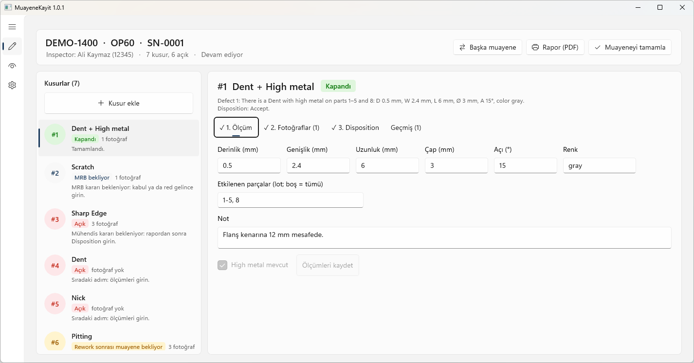

# MuayeneKayit

**Motor parçası görsel muayene kayıt sistemi.** Kusurları ölçümü, fotoğrafı ve kararıyla (disposition) birlikte kaydeder,
rework döngüsünü izler ve iki dilli (Türkçe / English) PDF rapor üretir.
Kurulum, veritabanı ve internet gerekmez: program ve kayıtlar şirket ağındaki bir klasörde durur.

[Tanıtım sayfası](https://akaymaz2635.github.io/MuayeneKayit/) · [Sunum](https://akaymaz2635.github.io/MuayeneKayit/sunum.html) ·
[Kurulum kılavuzu](KURULUM.md) · [Son sürüm](https://github.com/Akaymaz2635/MuayeneKayit/releases/latest) · [Test raporları](docs/test)



| | |
|---|---|
| **Tür** | Windows masaüstü uygulaması (WinUI 3, .NET 9), şirket içi kalite / muayene kaydı |
| **Platform** | Windows 10 1809+ / Windows 11, x64 ve ARM64 (Surface) |
| **Kurulum** | Yok. Ağ klasöründen çalışır, yönetici yetkisi gerekmez |
| **Veri** | JSON dosyaları + fotoğraflar, ortak ağ klasöründe. Veritabanı, bulut, telemetri yok |
| **Dil** | Arayüz Türkçe; rapor Türkçe / English; kusur tipleri ve karar adları İngilizce (standart terim) |

## İçindekiler

- [Ne yapar](#ne-yapar)
- [Kurulum (kullanmak için)](#kurulum-kullanmak-için)
- [Kullanım](#kullanım)
- [Admin paneli](#admin-paneli)
- [Kaynaktan derleme](#kaynaktan-derleme)
- [Proje yapısı](#proje-yapısı)
- [Testler ve güvenlik](#testler-ve-güvenlik)
- [Belgeler](#belgeler)

## Ne yapar

- **Kusur ve ölçüm:** Admin'in tanımladığı kusur tipleri (Dent, Nick, Scratch, Undercut…) ve tipe göre ölçüm alanları:
  Derinlik, Genişlik, Uzunluk, Çap, Açı, Renk ve Admin'den eklenen **ek ölçüm alanları** (ör. kabarık kusurlar için *Yükseklik, H*).
  mm ya da inch. Ölçümler otomatik kaydedilir; her düzeltme önce / sonra değeriyle geçmişe yazılır.
- **High metal:** pozitif metal yığılması yan kusur olarak işaretlenir; yalnızca high metal için rework yapılabilir.
- **Etkilenen parçalar:** lot muayenesinde kusurun görüldüğü parçalar (`1-5, 8`).
- **Fotoğraf:** kamera (Logitech C920, Surface arka kamera) ya da dosya. Kutu, daire, ok ve "#N" etiketiyle işaretleme,
  isteğe bağlı arka plan kaldırma. Orijinal fotoğraf hiç değişmez. Her fotoğraf bir bölgedir (3.1, 3.2).
- **Disposition:** Accept, Rework / Reinspect, Reinspect, Repair, Submit MRB, MRB kabul / red, Return to vendor, Scrap, Reopen, Void, geri alma.
- **Rework döngüsü:** rework sonrası *uygun*, *aynı kusur devam* (yeni ölçüm, artış / azalış otomatik) ya da *yeni hata*
  (yeni kusurlar açılır: "Defect 1 continues as Defect 5"). Çok bölgeli kusurda her bölge için ayrı sonuç.
  Kusur lotun yalnızca bir kısmında sürüyorsa *Kusurun devam ettiği parçalar* kutusuna kalan parçalar yazılır (ör. 1-5 → 1, 3, 5);
  giderilenler geçmişe ve rapora "giderildi: 2, 4" olarak girer. Ana ekrandaki *Etkilenen parçalar* değişikliği de düzeltme geçmişine yazılır.
- **Rapor:** yatay A4 PDF, Türkçe / English, her fotoğraf ayrı sayfa, karar geçmişi ve ölçüm düzeltmeleri. Sürümlü (v1, v2…).
- **Dashboard:** parça → operasyon → seri → kusur ağacı, süzme.
- **Denetim kaydı:** her işlem kim / ne zaman / ne bilgisiyle SHA-256 zincirli günlüğe yazılır; kayıtların özeti de zincire bağlanır.
- **Eşzamanlı çalışma:** birden çok muayeneci aynı klasöre yazar; dosya kilitleri ve atomik yazma kayıt bozulmasını önler.

Örnek rapor cümlesi:

```
Defect 1: There is a Dent with high metal on parts 1–5 and 8: D 0.5 mm, W 2.4 mm, H 0.2 mm.
Disposition: Rework / Reinspect.
```

## Kurulum (kullanmak için)

Ayrıntılı kılavuz: **[KURULUM.md](KURULUM.md)**. Kısaca:

1. [Releases](https://github.com/Akaymaz2635/MuayeneKayit/releases/latest) sayfasından `MuayeneKayit-<sürüm>.zip`'i indirin ve
   ağdaki bir **Program** klasörüne açın:
   ```
   \\sunucu\MuayeneKayit\Program\
     MuayeneKayit.exe            ← herkes bunu açar (başlatıcı)
     surum.txt                   ← açılacak sürüm, ör. 1.1.0
     1.1.0\Inspector-x64\  1.1.0\Inspector-arm64\
     MuayeneKayit.settings.json  ← ortak veri klasörünün yolu
   ```
2. `MuayeneKayit.settings.example.json`'ı `MuayeneKayit.settings.json` olarak kopyalayın ve **tam yol** olarak veri klasörünü yazın:
   ```json
   { "rootPath": "\\\\sunucu\\MuayeneKayit\\Veri" }
   ```
3. **İzinler (NTFS):** muayeneciler `Veri` klasörüne okuma + yazma; `Program` ve `Veri\_config` klasörlerine **yalnızca okuma**.
   Admin'ler `Veri\_config`'e yazabilir. Ayrıntı: [KURULUM.md §3](KURULUM.md).
4. Programı açın → sol menünün altındaki **Admin** → ilk açılışta 8-12 haneli PIN belirleyin → kusur tiplerini düzenleyip kaydedin.
5. Kullanıcılar: ağdaki `MuayeneKayit.exe` → sağ tık → *Gönder* → *Masaüstü (kısayol oluştur)*.

**Güncelleme:** yeni sürüm klasörünü Program klasörüne kopyalayın, sonra `surum.txt`'yi değiştirin.
Açık programlar eski sürümde çalışmaya devam eder; bir sonraki açılışta yeni sürüm gelir. Herkesin aynı sürüme geçmesi önerilir.

### Gereksinimler

| | |
|---|---|
| İşletim sistemi | Windows 10 1809 (17763) ya da üstü, Windows 11 |
| İşlemci | x64 ya da ARM64 |
| Çalışma zamanı | Gerekmez (self-contained; .NET ve Windows App SDK pakete dahil) |
| PDF | Microsoft Edge (Windows ile gelir). Edge yoksa rapor HTML olarak açılır |
| Kamera | İsteğe bağlı: USB kamera ya da tablet kamerası |
| Ağ | Ortak klasöre (SMB) erişim. İnternet gerekmez |

## Kullanım

1. **Muayeneyi aç:** parça, operasyon, seri no (önceki kayıtlardan öneri gelir) → *Create Inspection*.
2. **Kusur ekle:** tipi seçin; şablondaki ölçüm kutuları açılır.
3. **Ölçüm:** değerleri girin (otomatik kaydedilir). Yan kusur varsa *High metal mevcut*.
4. **Fotoğraf:** kamera ya da dosya; işaretleme ekranında kutu / daire / ok.
5. **Disposition:** kararı seçin; pencere sonucunu açıklar, onaylamadan kaydedilmez.
   Rework'te parça döndüğünde *Rework sonrası muayene sonucunu gir*.
6. **Rapor (PDF)** ve açık kusur kalmayınca **Muayeneyi tamamla**.

Ekran her an sıradaki adımı vurgular; tamamlanan adımlar ✓ alır. Ayarlar sekmesinde ölçü birimi (mm / inch) ve tema.

## Admin paneli

Programın içindedir: sol menü → **Admin** → PIN. Ayrı pencerede açılır; 10 dakika işlem yoksa ve pencere kapanınca kilitlenir.

| Sayfa | Ne yapılır |
|---|---|
| Kayıtlar | Tüm muayeneler, süzme, CSV dışa aktarma, klasörü / son raporu açma |
| Kusur tipleri | Tip listesi, sıralama, spec adı, ölçüm alanları; **ek ölçüm alanı tanımlama** (ad, kısaltma, tür: uzunluk / açı / sayı / metin) |
| Karar açıklamaları | Karar penceresinde gösterilen açıklamalar |
| Bakım | Eski kilit dosyaları, denetim zinciri ve kayıt bütünlüğü kontrolü |
| Ayarlar | Ortak veri klasörü, muayeneci adının Windows oturumundan alınması, PIN değiştirme |

Kusur tipi, ek alan ya da veri klasörü değişince muayene programlarının bir kez kapatılıp açılması gerekir.

## Kaynaktan derleme

| Gereken | Not |
|---|---|
| Visual Studio 2022 17.12+ | İş yükleri: *.NET masaüstü geliştirme*, *WinUI uygulama geliştirme* |
| .NET 9 SDK | Visual Studio ile gelir |
| Windows App SDK 1.8 | NuGet paketi; ilk derlemede iner (indirilemiyorsa: [KURULUM.md](KURULUM.md) > *Paketler inmiyorsa*) |

```powershell
git clone https://github.com/Akaymaz2635/MuayeneKayit.git
cd MuayeneKayit
dotnet run --project tests\MuayeneKayit.Tests     # tüm testler
.\build-release.ps1                               # dist\MuayeneKayit-<sürüm>.zip (x64 + ARM64)
```

Visual Studio'da: `MuayeneKayit.sln` → **Release | x64** → *Derle*; F5 programı açar.
Sürüm numarası yalnızca `Directory.Build.props` içinden değiştirilir.

## Proje yapısı

| Klasör | İçerik |
|---|---|
| `src/MuayeneKayit.Core` | Alan modeli, durum makinesi, JSON depolama + dosya kilidi, denetim zinciri, rapor, görüntü işleme. Yalnızca .NET BCL |
| `src/MuayeneKayit.Presentation` | ViewModel'ler (MVVM, CommunityToolkit.Mvvm); arayüzden bağımsız, testli |
| `src/MuayeneKayit.Inspector` | Program (WinUI 3): görünümler, diyaloglar, kamera, fotoğraf düzenleyici, Edge PDF, `Admin\` penceresi |
| `src/MuayeneKayit.Launcher` | Ağdaki başlatıcı (`MuayeneKayit.exe`): `surum.txt` ve mimariye göre doğru exe'yi açar |
| `tests/MuayeneKayit.Tests` | Bağımlılıksız test koşucusu: Core, senaryolar, eşzamanlılık, ViewModel, güvenlik |
| `dagitim/` | Pakete giren `OKU-BENI.txt` ve örnek ayar dosyası |
| `docs/` | Tanıtım sayfası, sunum, test planları ve raporları, tasarım planları |

Mimari: **MVVM + Ports & Adapters + DI**. Ayrıntı: [PLAN.md](PLAN.md), tasarım kuralları: [DESIGN.md](DESIGN.md).

Ortak veri klasörü düzeni:

```
Veri\
  _config\        defect_types.json, measure_fields.json, decision_texts.json, admin.json …
  _audit.log      denetim kaydı (SHA-256 zinciri) + _audit.head
  _index.json     dashboard index'i
  <Parça>\<Operasyon>\<Seri>\
    session.json
    defects\1.json, 1_photo_01.jpg, 1_photo_01_clean.jpg
    reports\Rapor_v1.pdf
```

## Testler ve güvenlik

```powershell
dotnet run --project tests\MuayeneKayit.Tests
```

- **Fonksiyonel test planı:** her düğme, her karar yolu, uçtan uca senaryolar, eşzamanlılık, bozuk dosya, ağ kopması →
  [plan](docs/test/FONKSIYONEL-TEST-PLANI.md) · [rapor](docs/test/FONKSIYONEL-TEST-RAPORU.md)
- **Güvenlik test planı:** yol doğrulama, rapor içeriği (CSP), CSV, PIN, denetim zinciri, kilitler, fotoğraf, başlatıcı, gizlilik →
  [plan](docs/test/GUVENLIK-TEST-PLANI.md) · [rapor](docs/test/GUVENLIK-TEST-RAPORU.md)

Program dış bağlantı kurmaz; telemetri ve otomatik güncelleme yoktur. Bir güvenlik sorunu bulursanız lütfen herkese açık issue
yerine depo sahibine doğrudan bildirin.

## Belgeler

| Belge | İçerik |
|---|---|
| [KURULUM.md](KURULUM.md) | Derleme, dağıtım, ilk açılış, NTFS izinleri, kamera, PDF |
| [dagitim/OKU-BENI.txt](dagitim/OKU-BENI.txt) | Paketle gelen kısa kurulum notu |
| [PLAN.md](PLAN.md) | Program planı, akış, disposition modeli |
| [DESIGN.md](DESIGN.md) | Arayüz tasarım kuralları |
| [docs/sunum.html](docs/sunum.html) | Tanıtım sunumu (tarayıcıda açılır, ok tuşlarıyla gezilir) |
